# 🐾 Mochi the Cat

A fun, interactive profile site for a cat named Mochi, plus an 8-bit **Whack-a-Mouse** game to keep visitors playing.

**Live site:** https://jordanistan.github.io/mochi-the-cat/

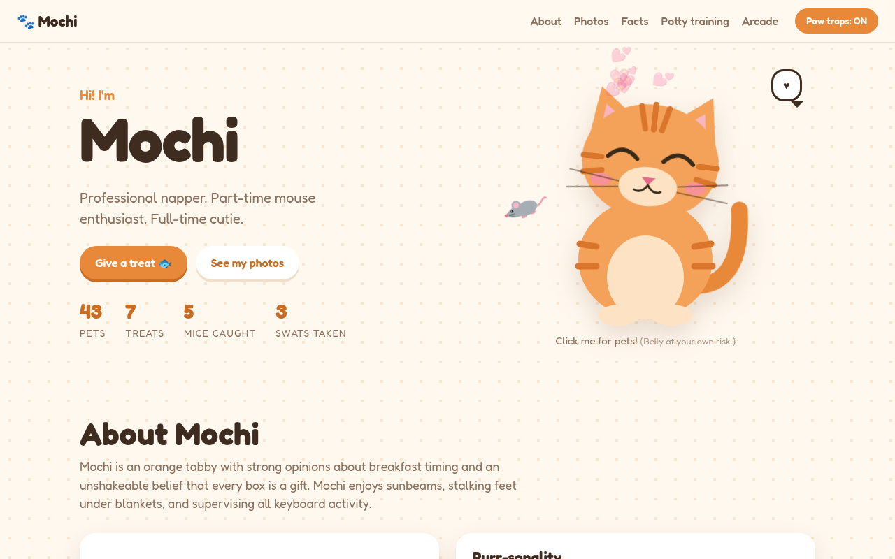

---

## Features

### 🐭 You are the mouse

When the page loads, your cursor turns into a little grey mouse. It turns to face the way it's moving, wags its tail and scurries its feet. It also sniffs at anything clickable.

### 🐾 Don't go near the edges

If the mouse lingers near any edge of the screen, an orange tabby paw peeks in, wiggles and lunges with its claws out. If the paw catches the mouse, it pins it and drags it off-screen. If you dart back to the middle in time, the mouse escapes. The **Paw traps** button in the nav turns the paw off for visitors who just want to browse.

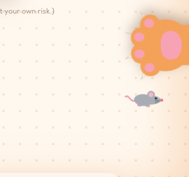

### 😺 Pet Mochi (but not the belly)

- **Click Mochi** for pets: purring, hearts and happy eyes. Mochi's eyes follow the mouse wherever it goes.
- **Give a treat** to toss a fish into Mochi's mouth. *Nom nom nom.*
- **The belly is a trap**, like it is on a real cat. Hovering over it makes the tail start flicking as a warning. If you click anyway, Mochi flattens its ears, narrows its pupils, puffs up its fur, hisses and swats you, leaving scratch marks. Mochi stays mad for a few seconds, though a treat will earn your forgiveness.
- About **1 in 10** belly clicks, Mochi allows a 🌟 **rare belly rub**.

The page counts pets, treats, mice caught and swats taken.

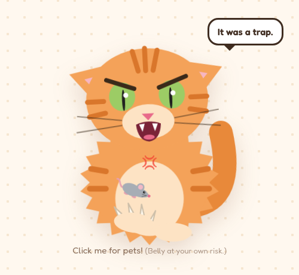

### 📋 About Mochi

Details like breed, age, favorite toy and greatest weakness, plus a **Purr-sonality** chart whose bars fill in as you scroll to them.

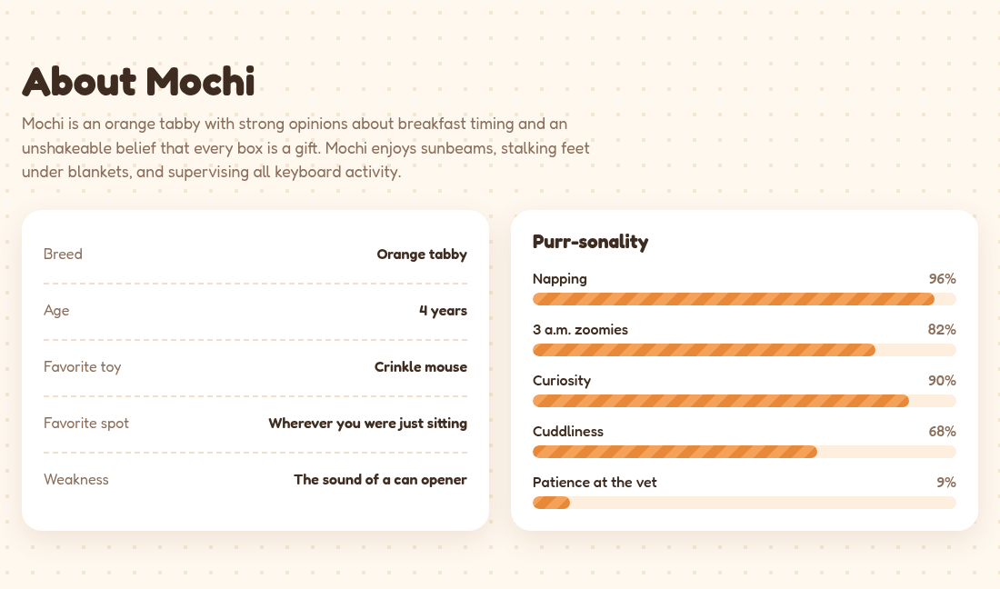

### 📸 Photo gallery

Tilted Polaroid-style photos that straighten up when you hover over them. Click a photo to see it full size (use the arrow keys to browse and Esc to close), and tap the ♥ to like it.

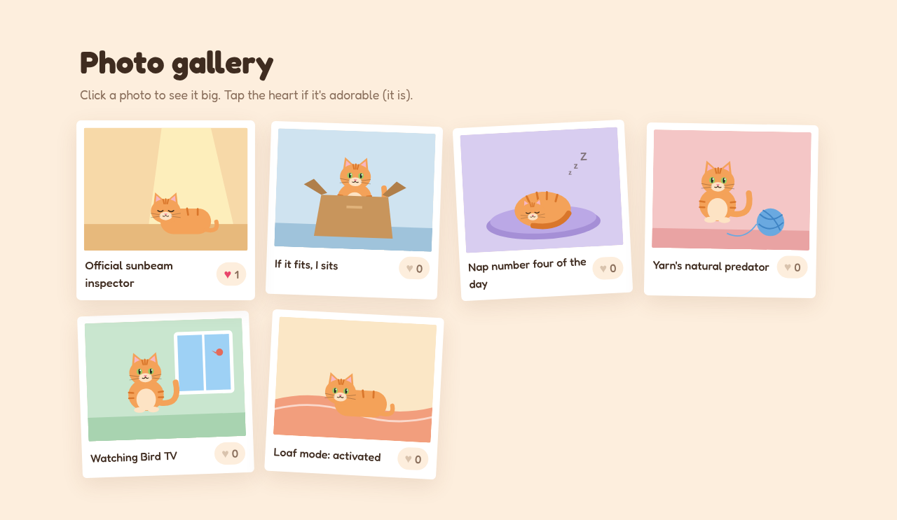
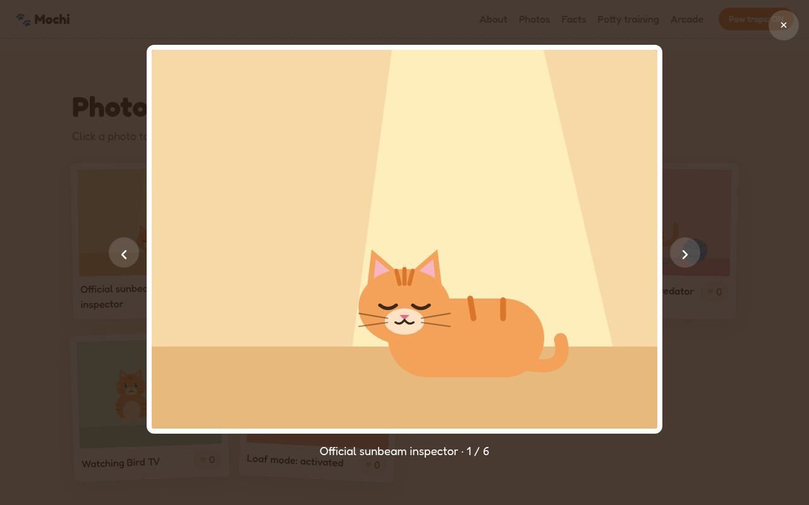

### 💡 Fun facts

Flip cards that reveal Mochi's best facts, from sock theft to gravity experiments with cups.

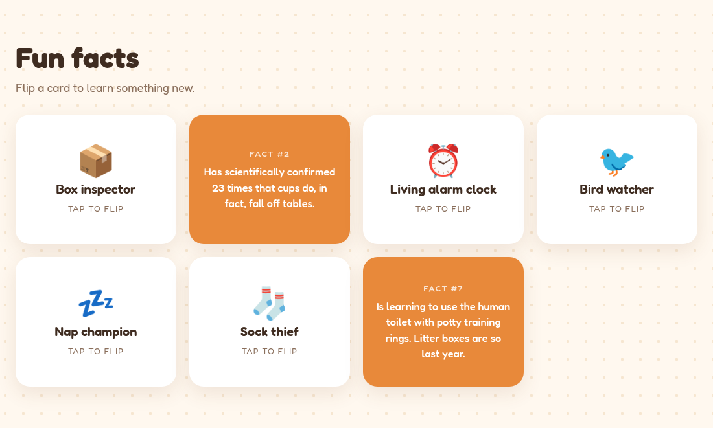

### 🚽 Potty training journey

Mochi is learning to use the toilet with a ring-based training seat. This section is a step-by-step guide for other cat owners who want to try it:

- An illustration of the toilet updates for each stage as rings come out and the hole gets bigger.
- Each of the 5 stages has a **how-to checklist**, a **typical timeframe**, and a **"Move on when"** sign that your cat is ready for the next stage.
- **Before you start** tips and an honest **Good to know** list of caveats (vet check, health monitoring, local rules on flushing cat waste, plumbing).
- A **Cheer them on 🎉** button with confetti.

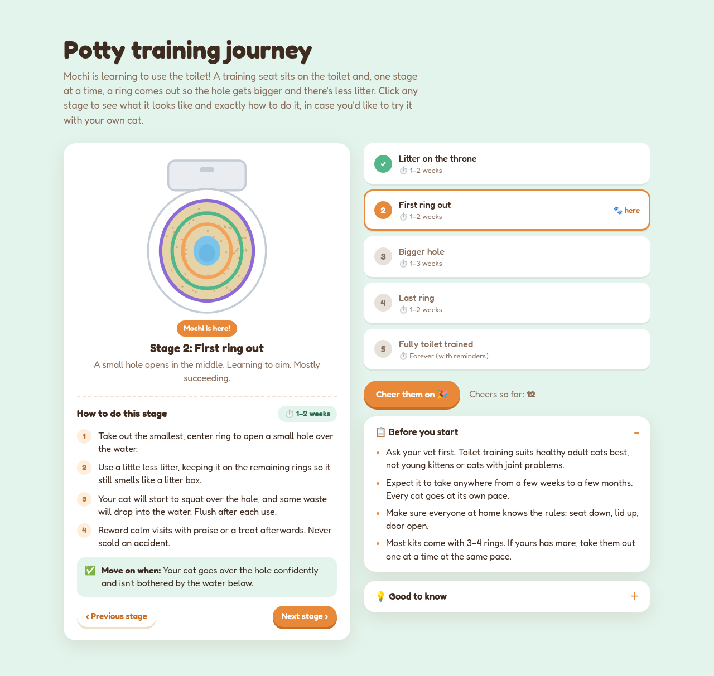

### 🕹️ Whack-a-Mouse (a separate game page)

An NES-style game at [`/game/`](https://jordanistan.github.io/mochi-the-cat/game/), linked from the Arcade section of the profile:

- The screen is NES resolution (256×240), scaled up with crisp pixels and CRT scanlines.
- You play as **the cat's paw**: click to bonk the mice popping out of 9 holes.
- Rounds last **60 seconds** and speed up as the clock runs down.
- **Gold mice** are worth 50 points, and hitting mice in a row builds combo bonuses.
- It has 8-bit sound effects (press **M** to mute) and saves your high score, which also shows on the profile page.

| Title screen | Gameplay |
| --- | --- |
| 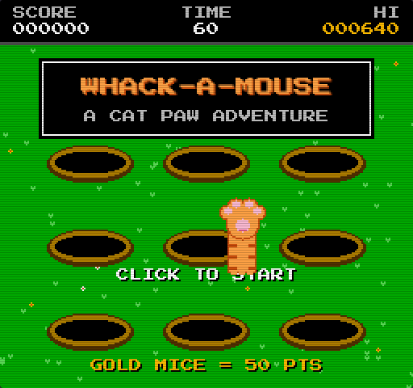 | 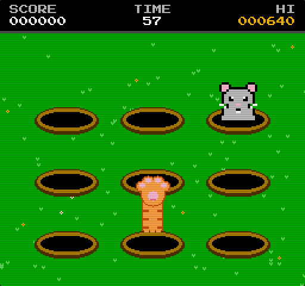 |

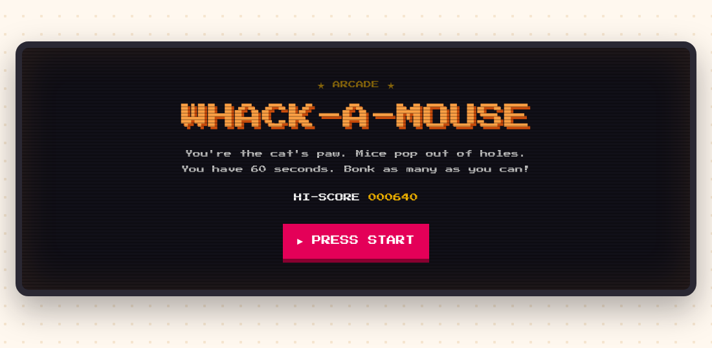

---

## Make it your own cat

Everything about the cat lives in **[`src/cat.js`](src/cat.js)**:

| Field | What it controls |
| --- | --- |
| `name`, `tagline`, `bio` | The hero section and About text (the name appears all over the site) |
| `details` | The details card (breed, age, favorite toy and more) |
| `traits` | The Purr-sonality bars (0–100) |
| `facts` | The flip cards (`icon`, `title`, `fact`) |
| `pottyTraining.currentStage` | Which stage shows "🐾 here" (0 = stage 1) |
| `pottyTraining.stages` | Each stage's text, timeframe, how-to steps and "Move on when" sign |
| `photos` | The gallery |

**Adding real photos:** put them in `public/photos/` and list them in `photos` like this:

```js
{ src: 'photos/mochi-on-the-couch.jpg', caption: 'Couch potato' },
```

The current gallery images are illustrated placeholders.

Other settings you can change:

- Belly rub odds: `BELLY_RUB_CHANCE` in `src/profile.js`
- How fast and far the paw reaches: the constants at the top of `src/cursor.js`
- Game length and difficulty: `GAME_LENGTH` and `spawnMouse()` in `src/game.js`

---

## Running locally

### With Docker (recommended)

```bash
docker compose up dev                    # http://localhost:5173, reloads when you save a file
docker compose --profile prod up prod    # production build served by nginx on http://localhost:8080
```

### Without Docker

Requires Node.js 20.19+ or 22.12+.

```bash
npm install
npm run dev       # http://localhost:5173 (also reachable from other devices on your network)
npm run build     # builds the static site into dist/
npm run preview   # serves the built site
```

---

## Deploying

The site is hosted on **GitHub Pages**. Every push to `main` runs [`.github/workflows/deploy.yml`](.github/workflows/deploy.yml), which builds the site and publishes it, so the live site updates within a minute or two:

```bash
git add -A && git commit -m "Add new photos of Mochi" && git push
```

---

## Project structure

```
├── index.html              # profile page
├── game/index.html         # Whack-a-Mouse page
├── src/
│   ├── cat.js              # ✏️ all of Mochi's content: edit this one
│   ├── profile.js          # profile page interactions (petting, gallery, facts, potty guide)
│   ├── profile.css         # profile page styles
│   ├── cursor.js           # mouse cursor + edge-grabbing paw
│   ├── game.js             # Whack-a-Mouse (all pixel art is drawn in code)
│   └── game.css            # game page styles
├── public/photos/          # gallery images
├── docs/screenshots/       # images used in this README
├── Dockerfile              # dev, build and nginx production targets
├── docker-compose.yml
└── vite.config.js
```

## Built with

- Plain HTML, CSS and JavaScript, with no framework
- [Vite](https://vite.dev/) for the dev server and builds
- The Web Audio API for purrs, hisses and 8-bit sounds, all generated in code
- Hand-drawn SVG for the cats and canvas pixel art for the game
- Google Fonts: [Fredoka](https://fonts.google.com/specimen/Fredoka) and [Press Start 2P](https://fonts.google.com/specimen/Press+Start+2P)

Notes:

- On touch screens, the mouse cursor and paw are turned off, and everything else works with taps.
- Counters, likes and high scores are saved in each visitor's own browser. They aren't shared between visitors.
